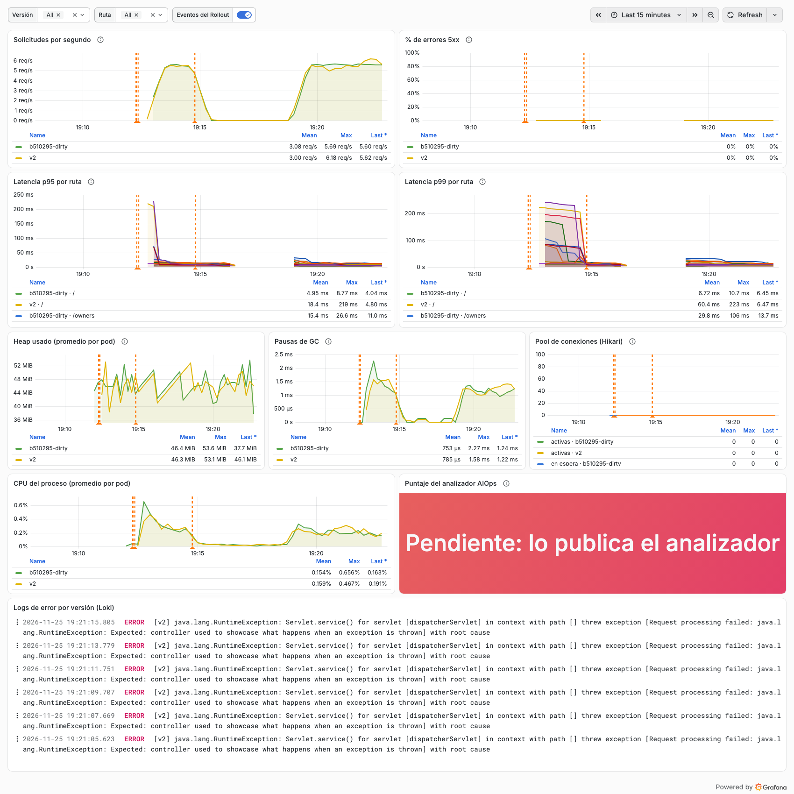
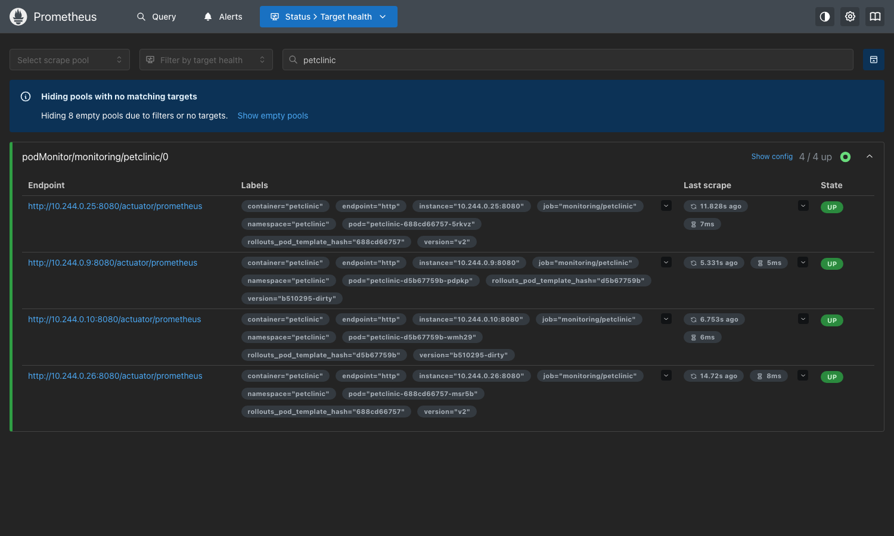

# Pruebas de la fase 3 (observabilidad) · 25/11/2026 19:18 · Mac M5 Pro, Docker Desktop, kind

## Pods de monitoring
```
NAME                                                    READY   STATUS    RESTARTS   AGE
alert-sink-599f748745-lph6j                             1/1     Running   0          7m40s
alertmanager-kps-kube-prometheus-stack-alertmanager-0   2/2     Running   0          7m21s
alloy-758f96785b-5c6vb                                  2/2     Running   0          8m28s
kps-grafana-87c7d969b-rk4g8                             3/3     Running   0          39s
kps-kube-prometheus-stack-operator-69748c99d6-22srq     1/1     Running   0          15m
kps-kube-state-metrics-8d5cb65f9-xf7lk                  1/1     Running   0          15m
loki-0                                                  2/2     Running   0          9m18s
prometheus-kps-kube-prometheus-stack-prometheus-0       2/2     Running   0          15m
```

## Pods de PetClinic leídos por Prometheus (obs.sh status)
```
[obs] Pods de PetClinic que Prometheus está leyendo (up=1 es OK):
  petclinic-d5b67759b-wmh29  version=b510295-dirty  up=1
  petclinic-d5b67759b-pdpkp  version=b510295-dirty  up=1
  petclinic-688cd66757-msr5b  version=v2  up=1
  petclinic-688cd66757-5rkvz  version=v2  up=1
```

## Alertmanager: agrupación e inhibición con alertas sintéticas
Se enviaron 4 alertas: PetclinicDown (vtest-a), PetclinicHighLatency (vtest-a) y dos PetclinicHighLatency de pods distintos (vtest-b).

```
Estado en Alertmanager:
  PetclinicDown          version=vtest-a  active
  PetclinicHighLatency   version=vtest-a  suppressed (inhibida por PetclinicDown)
  PetclinicHighLatency   version=vtest-b  active
  PetclinicHighLatency   version=vtest-b  active
Notificaciones recibidas por alert-sink:
  grupo {"alertname": "PetclinicDown", "version": "vtest-a"} -> 1 alerta(s)
  grupo {"alertname": "PetclinicHighLatency", "version": "vtest-b"} -> 2 alerta(s)
```
Resultado: 4 alertas → 2 notificaciones. La latencia de la versión caída queda inhibida y las alertas de dos pods de la misma versión llegan en un solo aviso.

## Dashboard "PetClinic Blue vs Green" durante un despliegue

`bg.sh deploy v2 --window 2m` (smoke tests y k6 en verde) y luego `bg.sh load 240` contra las dos versiones.
Se llamó 6 veces a `/oups` en la preview (v2) para generar errores provocados.



Qué se comprueba en la captura:
- Las dos versiones (`b510295-dirty` estable y `v2` preview) aparecen separadas en todos los paneles.
- % de errores 5xx en 0 % para ambas: los 500 de `/oups` se excluyen, como pide la propuesta.
- Los logs de error de Loki muestran los 6 errores de `/oups` con la versión `v2`.
- Las líneas naranjas son eventos del Rollout (análisis, escalado de réplicas) tomados de Kubernetes.
- El panel del puntaje queda en "Pendiente" hasta que el analizador publique `aiops_analyzer_score`.

## Prometheus lee los 4 pods con su versión



Cada objetivo conserva `version` y `rollouts_pod_template_hash` (4/4 up).

## Problemas encontrados y cómo se resolvieron

| Problema | Causa | Solución |
|---|---|---|
| Alertmanager no arrancaba | El chart agrega una ruta por defecto hacia un receptor `"null"` que la configuración no definía | `routes: []` y receptor `"null"` declarado en `values/kube-prometheus-stack.yaml` |
| Grafana con CPU al 1300 % y dashboard sin cargar | Límite de memoria de 384 MiB: Grafana 13 quedaba al límite y el kernel lo frenaba | Límite subido a 1 GiB |
| `obs.sh status` no respondía | La imagen de Prometheus no trae `wget` | La consulta va por el proxy de la API de Kubernetes |
| Panel de 5xx en "No data" sin errores | La división no devuelve series cuando el numerador está vacío | `or total * 0` para mostrar 0 % |
